MIMIC:Imitates Machines, Inspects Code

A cycle-accurate multi-machine emulator in Rust. Every machine gets the same remote debugger and a live preview stream (see `CLAUDE.md` and `docs/claude/` for architecture and commands, `docs/` for usage).

The user guide — how to use the emulator plus the complete reference of every option, the start profiles and the web front end — is `docs/mimic-user-guide-en.pdf` (English) and `docs/mimic-user-guide-de.pdf` (German); both ship with every release package and the web bundle. Regenerate them with `python tools/user_guide.py` (needs `reportlab`; the text is in `tools/guide_en.py` and `tools/guide_de.py`).

## Screenshots

Power-on screens and desktops from the emulator itself (`mimic-headless --snapshot`, the TV machines with their pixel aspect; the Archimedes desktop from the `archimedes` test after `*DESKTOP`, the punched card from the `keypunch` test, the BBC Micro's teletext test page and the Master's `*TIME` from the `bbc_boot` tests); the consoles without a start screen show a game. ROMs and software are not part of this repository.

<table>
<tr>
<td align="center" valign="top" width="33%"> <b>Commodore 64</b> BASIC V2</td>
<td align="center" valign="top" width="33%">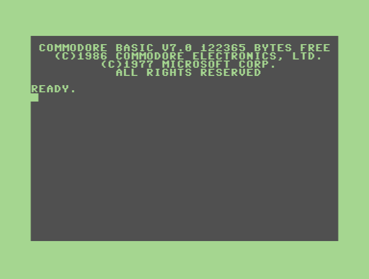 <b>Commodore 128</b> BASIC 7.0, 40 columns</td>
<td align="center" valign="top" width="33%"> <b>Commodore 128</b> 80 columns on the VDC</td>
</tr>
<tr>
<td align="center" valign="top" width="33%"> <b>VIC-20</b> BASIC V2</td>
<td align="center" valign="top" width="33%">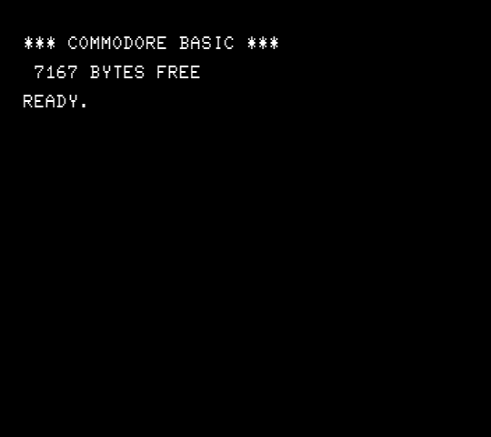 <b>PET 2001</b> BASIC 1.0</td>
<td align="center" valign="top" width="33%"> <b>PET 8032</b> BASIC 4.0, 80 columns</td>
</tr>
<tr>
<td align="center" valign="top" width="33%">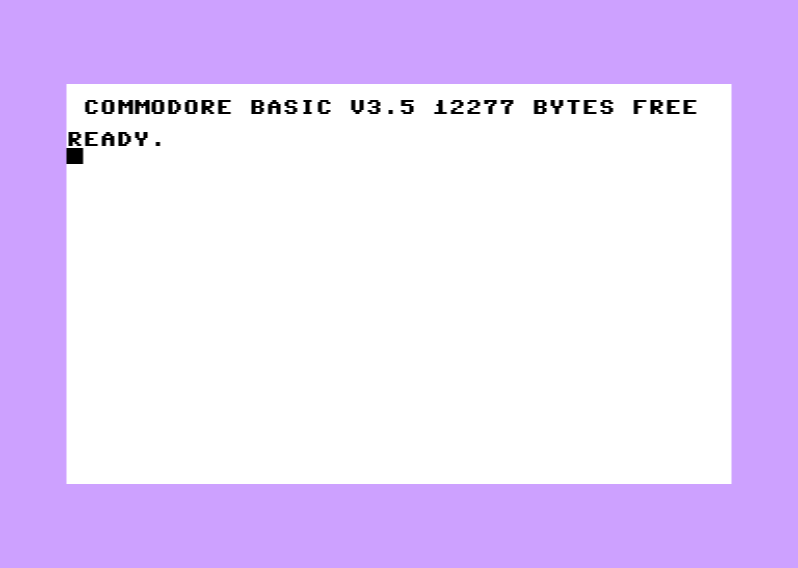 <b>Commodore 16</b> BASIC 3.5</td>
<td align="center" valign="top" width="33%"> <b>Plus/4</b> BASIC 3.5</td>
<td align="center" valign="top" width="33%"> <b>Amiga 500</b> Workbench 1.3</td>
</tr>
<tr>
<td align="center" valign="top" width="33%"> <b>Amiga 1200</b> Kickstart 3.1</td>
<td align="center" valign="top" width="33%"> <b>Macintosh Plus</b> System 6.0.8 Finder</td>
<td align="center" valign="top" width="33%"> <b>Archimedes A310</b> RISC OS 3.11 Desktop</td>
</tr>
<tr>
<td align="center" valign="top" width="33%"> <b>Atari 800XL</b> Atari BASIC</td>
<td align="center" valign="top" width="33%"> <b>Amstrad CPC 6128</b> BASIC 1.1</td>
<td align="center" valign="top" width="33%"> <b>ColecoVision</b> BIOS title</td>
</tr>
<tr>
<td align="center" valign="top" width="33%">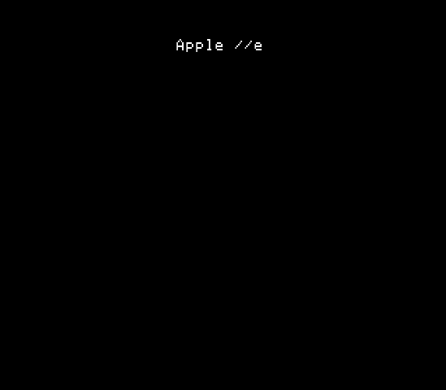 <b>Apple IIe</b> Power-on</td>
<td align="center" valign="top" width="33%"> <b>ZX Spectrum 128K</b> Start menu</td>
<td align="center" valign="top" width="33%">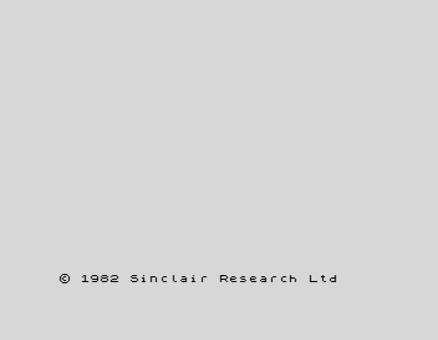 <b>ZX Spectrum 48K</b> Power-on</td>
</tr>
<tr>
<td align="center" valign="top" width="33%"> <b>ZX81</b> BASIC prompt</td>
<td align="center" valign="top" width="33%"> <b>IMSAI 8080</b> Front panel, clickable</td>
<td align="center" valign="top" width="33%">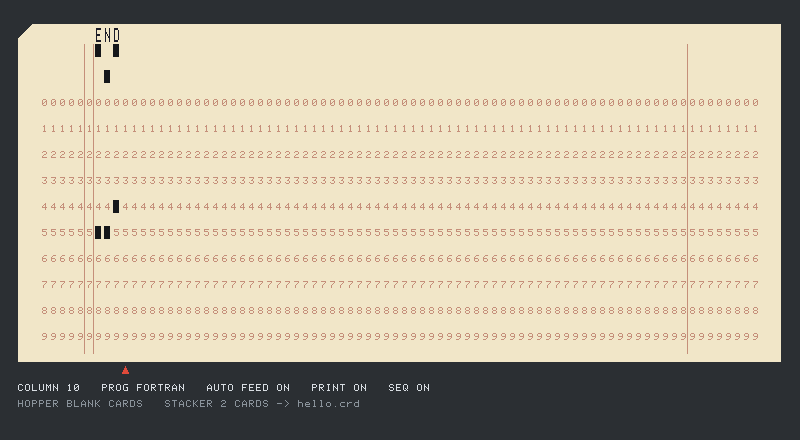 <b>IBM 029 Card Punch</b> A FORTRAN deck's END card</td>
</tr>
<tr>
<td align="center" valign="top" width="33%"> <b>NES</b> <i>Track &amp; Field II</i></td>
<td align="center" valign="top" width="33%"> <b>SNES</b> <i>Sonic the Hedgehog 4</i></td>
<td align="center" valign="top" width="33%"> <b>Atari 2600</b> <i>Pitfall II</i></td>
</tr>
<tr>
<td align="center" valign="top" width="33%"> <b>Vectrex</b> Power-on</td>
<td align="center" valign="top" width="33%">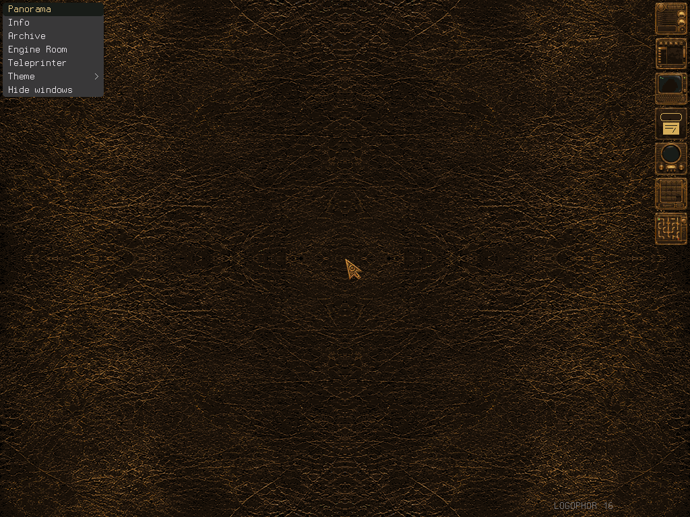 <b>Logophor 16</b> Panorama desktop</td>
<td align="center" valign="top" width="33%">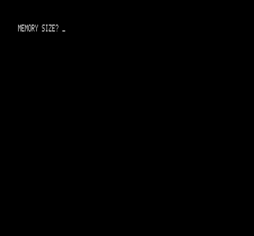 <b>TRS-80 Model I</b> Level II BASIC power-on</td>
</tr>
<tr>
<td align="center" valign="top" width="33%">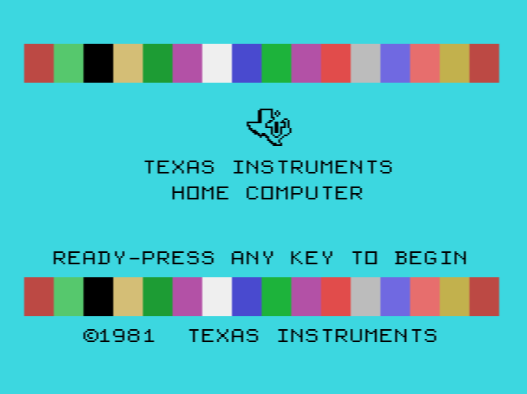 <b>TI-99/4A</b> Title screen</td>
<td align="center" valign="top" width="33%">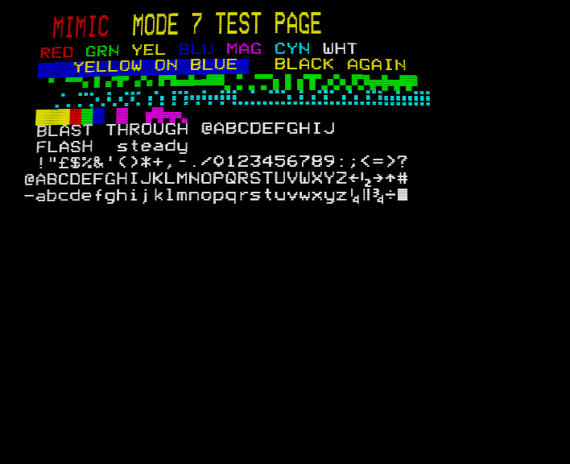 <b>BBC Micro Model B</b> Mode 7 teletext test page</td>
<td align="center" valign="top" width="33%">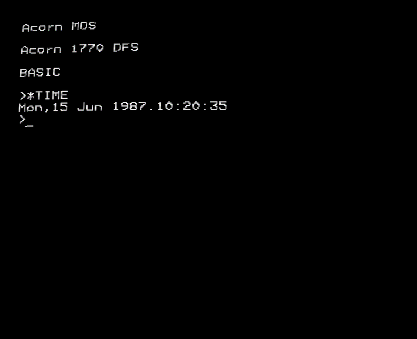 <b>BBC Master 128</b> MOS 3.20, <code>*TIME</code> from the clock</td>
</tr>
</table>

## Test overview

Where the project stands against test suites and checks, as of 2026-11-11. 🟢 everything passes (or every remaining case is a known reference problem), 🟡 most passes with open cases, 🔴 not verified or largely failing, ⚪ not started. Details and trends: `docs/claude/testing.md`, `docs/test-results-c64.md` and the phase files in `docs/claude/phases/`.

### CPUs

| CPU | Test suite | Result | State | Open |
| --- | --- | --- | --- | --- |
| 6502 / 6510 / 8502 (NMOS) | Tom Harte `6502`, Klaus Dormann, Lorenz 2.15, VICE `CPU/` | 2 560 000/2 560 000, passed, 264/264, 115/115 | 🟢 | – |
| Ricoh 2A03 (NES) | Tom Harte `nes6502`, blargg instr tests | all green | 🟢 | – |
| CMOS 65C02 (Apple IIe enhanced) | Tom Harte `synertek65c02` | 256 000/256 000 | 🟢 | no Rockwell/WDC bit instructions, WAI/STP |
| 7501/8501 (TED) | VICE Plus/4 list, xplus4 traces | 12/12 | 🟢 | – |
| Z80 | Tom Harte, ZEXDOC/ZEXALL, Fuse test (Spectrum), VICE C128 Z80 timing | green; C128 Z80 timing 1865/1871 | 🟡 | ZEXALL of the C128 list never run (hours) |
| Intel 8080A | TST8080, 8080PRE, CPUTEST, 8080EXM | all pass with the published T-state totals | 🟢 | – |
| 68000 | Tom Harte (all but three contradictory cases), WinUAE comparison | green; WinUAE 260/504 | 🟡 | WinUAE comparison rows |
| 68020 / 68EC020 | own random tests | 98.1 % (seed 1) | 🟡 | CMP2/CHK2 N/V, disk seed 2 |
| 65C816 (SNES 5A22) | Tom Harte | 5 080 400/5 080 400 | 🟢 | – |
| SPC700 | Tom Harte | 256 000/256 000 | 🟢 | – |
| 6809 (Vectrex) | own per-instruction tests (no external suite) | green | 🟡 | no external suite |
| TMS9900 (TI-99/4A) | own per-instruction tests (results, status bits, datasheet clock cycles), TI BASIC with the real ROMs | 19/19, TI BASIC runs | 🟡 | no external suite; DIV time fixed at 108 cycles |
| ARM2 (Archimedes) | own tests, RISC OS boot | green | 🟡 | no external suite |
| Ada (Logophor 16) | own tests | green | 🟢 | – |

### Machines

| Machine | Test suite / check | Result | State | Open |
| --- | --- | --- | --- | --- |
| C64 | VICE `c64-testlist.in`, Lorenz | 1173/1240 projected (94.6 %), Lorenz 264/264 | 🟡 | `VICII/` 229/273 (`videomode` 27), `SID/` 155/169, `drive/` 45/51, `C64/` 68/70; REU, GEO-RAM not emulated |
| C128 | VICE `c128-testlist.in` (without 135 ZEXALL parts) | 1976/2015 (98.1 %); `mmu/` 30/30, `c64modemmu` 51/51, `z80/` 1871/1871, `2mhzVIC` 4/4, `vic-mmu`, `burstmode` | 🟡 | `d030tester` 0/33 deferred (VICE's PAL hue shift), `drive/scanner` 1571 (3), `vdcdump` (right result, but ~5 % past the cycle limit), `ifnram`, `c128modezp0001` (test bug: `ldx $d7ff`); ZEXALL never run |
| VIC-20 | VICE `vic20-testlist.in` | 72/72 | 🟢 | screenshot entries not compared |
| C16 / Plus/4 | VICE `plus4-testlist.in`, xplus4 traces and pictures | 12/12; FLI, palette, fetch pipeline pixel-equal | 🟡 | TED split (window writes), `flicnt` |
| PET | VICE `pet-testlist.in` | 13/16 | 🟡 | `crtc3`, `crtc13` (references marked FIXME), `crtc10` (8296 behaviour) |
| Atari 400/800/XL/XE | Acid800 | 57/57 (800XL, 130XE), 56/57 (800, correct), 56/56 (400) | 🟢 | – |
| Atari 2600 | own TIA/RIOT tests, 24 games, Pitfall II | green | 🟡 | Supercharger, SECAM |
| Amstrad CPC | Arnold acid tests (CRTC type 1) | 90/98 | 🟡 | PPI mode 1, VSYNC port read, `crtctest` R8 count (several fail on real CPCs too); CRTC 0 18/22, 2 18/23 |
| Amiga 500/1000/2000 (OCS) | WinUAE comparison, bus tests on a real A500 | 260/504; bus timing within 1.8 % | 🟡 | WinUAE rows, bus test 5 latency |
| Amiga 500+ (ECS) | Kickstart 2.0/3.1 boot | insert-disk screen | 🟡 | programmable beam registers |
| Amiga 1200 (AGA) | Kickstart 3.1 boot, bus tests on a real A1200 | within 4 % | 🔴 | Workbench 3.x not booted (needs an ADF) |
| ZX81 | boot, PRINT, .P files | works | 🟡 | no test suite |
| ZX Spectrum 48K/128K/+2 | Fuse test | all pass | 🟢 | border timing beyond the Fuse test, SAVE to tape |
| ColecoVision | cartridge collection | 231/235 show a picture | 🟡 | TMS9918A reference pictures, VRAM timing |
| NES | nes-test-roms (blargg, nestest …) | 116/119 | 🟡 | `6-MMC3_alt`, `blargg_apu_2005` 10 and 11 |
| SNES | Harte CPU sets, snes-tests (gilyon), PeterLemon's ROMs | snes-tests 3/3, PeterLemon 67/78, games run with sound, DSP-1 commands correct | 🟡 | mid-line register changes, input-driven PeterLemon pictures, coprocessors beyond the NEC DSPs |
| Vectrex | executive, Mine Storm, Scramble | play | 🟡 | overlays, phosphor persistence |
| Apple II / II+ / IIe | real ROMs, Zork I, test disks | all four boot | 🟡 | DOS 3.3/ProDOS, Mockingboard software, WOZ protections |
| Macintosh 128K–SE | real ROMs, test disk, System 6/7 | boot | 🟡 | 1.44 MB (SWIM), ADB handshake details |
| Archimedes A310/A440 | RISC OS boot, ADFS | boots, reads discs | 🟡 | timing simplified, no podules/hard disc |
| IMSAI 8080 | CP/M 2.2 from FIF floppy, card reader | boots | 🟡 | FIF interrupt jumper, 88-SIO status bits |
| IBM 029 keypunch | own tests, IMSAI reads decks | green | 🟢 | – |
| Logophor 16 | own tests, Foundry ROM golden images | steps 1–11 accepted | 🟢 | Steampunk machine |
| TRS-80 Model I / III | Level II and Model III ROMs (`trs80_boot`, 7 tests) | both boot to BASIC and compute; Model I block graphics, CSAVE/CLOAD; both boot and write a test disk (FD1771 SD, FD1793 DD with WAIT/NMI) | 🟡 | a real DOS disk, Model III cassette |
| TI-99/4A | real ROMs (`ti99_boot`, 5 tests) | title screen, menu, TI BASIC computes; Parsec from its C/G dumps; SAVE/OLD on cassette (WAV) and on disk (TI disk controller); Parsec talks through the Speech Synthesizer | 🟡 | speech excitation by ear against hardware, GROM/VDP access timing, inverted (379) banking |
| BBC Micro B / B+ / B+ 128 / Master 128 | real ROMs (`bbc_boot`, 19 tests) | all four boot to BASIC; mode 7 against its reference picture; SAVE/LOAD on tape (UEF), on DFS discs (8271, 1770) and ADFS; SHIFT+BREAK boots a disc; the Master's clock, shadow RAM and keypad | 🟡 | no commercial discs or tapes tried; Tube, Econet, ADC missing |
| Colour Genie, CPC Plus, QL, Atari ST, KC85, KIM-1, HP calculators | – | – | ⚪ | planned phases |

### Drives, devices and frontends

| Component | Check | Result | State | Open |
| --- | --- | --- | --- | --- |
| 1541 (true drive) | VICE `drive/` | 45/51 | 🟡 | `drive-emu-check`, P64 images missing |
| 1571 / 1581 | C128 tests `c128_1571`, `c128_1581` | green | 🟢 | – |
| 1551 (TCBM) | VICE `Plus4/tcbm`, Promised Land | green | 🟢 | – |
| SD2IEC (C64) | `c64_sd2iec` with the real KERNAL, bus-level tests | 4/4, 26 unit tests | 🟡 | fast loaders (JiffyDOS), RTC, REL inside images |
| TI disk controller (FD1771), TI cassette | `ti99_boot` | SAVE/OLD round trips | 🟡 | double-sided disks through the DSR untested |
| True 2031 (IEEE-488) | – | – | ⚪ | not built |
| Amiga floppy, Atari SIO, CPC disc, Disk II, Sony 400K/800K | machine boots with images | green | 🟡 | Mac 1.44 MB |
| Greaseweazle / OpenCBM backends | simulated devices; Greaseweazle on the owner's A500/A1200 discs | flux import byte-equal | 🟡 | Phase 8 gate (more measuring discs) |
| SID | VICE `SID/` | 155/169 | 🟡 | 14 open |
| CIA | VICE `CIA/`, `interrupts/` | 188/188, 39/39 | 🟢 | – |
| VIA | VICE `VIC20/via_sr` dumps, `drive/viavarious` | green | 🟢 | – |
| Joysticks, paddles, mice, keypads, light pens | unit tests at pin level | green | 🟡 | interactive VICE tests checked by hand only |
| Cartridges (C64 CRT, freezers, VIC-20, Plus/4, C128 function ROM, Atari, Coleco, NES mappers 0–4, SNES with DSP-1–4) | `cartridges` tests, VICE selftests | green | 🟡 | more NES mappers, SNES coprocessors beyond the DSPs |
| Printers (FX-80, P6+, ImageWriter) | real ROMs on several machines | print | 🟡 | Amiga printer.device, more machines |
| Debug server, VICE monitor adapter, preview | `emu-debug`/`emu-preview` tests | green | 🟢 | – |
| Desktop, headless | smoke tests | green | 🟢 | – |
| Web (WASM) | headless Chrome check | runs | 🟡 | no file host for printers |

## Status

**Completeness** estimates how much of the planned scope of a component works and is covered by tests. 100 % means the full scope is done and checked against hardware test suites. Below that, the notes name what is missing or unverified. The figures are estimates, made from the test results and open items recorded in `CLAUDE.md` (as of 2026-10-24); they are not measurements.

### CPUs

| CPU | Crate | Used in | Verification | Completeness |
| --- | --- | --- | --- | --- |
| MOS 6502 family: 6502, 6510, 8502, 7501/8501, 6502C (SALLY), 6507, Ricoh 2A03/2A07, CMOS 65C02 | `cpu-6502` | PET, VIC-20, C64, C128, C16/Plus/4, 1541/1571/1581, Atari 8-bit, Atari 2600, NES, Apple II, BBC Micro (Master: 65SC12) | Tom Harte (6502, nes6502, synertek65c02), Klaus Dormann, Lorenz 264/264 | 97 % (no Rockwell/WDC bit instructions, WAI/STP) |
| Zilog Z80 | `cpu-z80` | C128, CPC, ZX81, ColecoVision | Tom Harte, ZEXDOC, ZEXALL | 97 % |
| Motorola 68000 | `cpu-m68k` | Amiga 500/1000/2000/500+, Macintosh | Tom Harte (all but three contradictory cases) | 97 % |
| Motorola 68020 / 68EC020 | `cpu-m68k` | Amiga 1200 | unit tests only; timing approximate, no cache | 60 % |
| WDC 65C816 (5A22) | `cpu-65816` | SNES | Tom Harte, all 5 080 400 tests | 95 % |
| Sony SPC700 | `cpu-spc700` | SNES sound module | Tom Harte, all 256 000 tests | 98 % |
| NEC µPD77C25 | `cpu-upd7725` | SNES DSP-1 to DSP-4 | own tests; DSP-1B program: multiply, sine/cosine, distance, inverse | 85 % |
| Motorola 6809 (68A09) | `cpu-6809` | Vectrex | own per-instruction tests (cycle counts from the datasheet); the Vectrex executive and Scramble run; no external test suite | 75 % |
| Texas Instruments TMS9900 | `cpu-tms9900` | TI-99/4A | own per-instruction tests (clock cycles and wait states from the datasheet); TI BASIC and Parsec run; no external test suite | 80 % |

### Machines

| Machine | Crate | Models | Verification / state | Completeness |
| --- | --- | --- | --- | --- |
| Commodore 64 | `machine-c64` | PAL, NTSC | Lorenz 264/264; debugged with VS64 through the VICE monitor | 95 % |
| Commodore VIC-20 | `machine-vic20` | PAL, NTSC, RAM expansions | boots BASIC, tape, cartridges | 85 % |
| Commodore PET | `machine-pet` | 2001, 3032, 4032, 8032 | boots BASIC; IEEE drive virtual only (no true 2031) | 85 % |
| Commodore C16 / Plus/4 | `machine-ted` | PAL, NTSC | boots BASIC, tape, cartridges | 85 % |
| Commodore 128 | `machine-c128` | 40/80 columns, Z80 | boots BASIC; VDC; 1571 | 80 % |
| Atari 400/800/800XL/65XE/130XE | `machine-atari8` | PAL, NTSC | Acid800 52/57 (800XL, 130XE); 5 ANTIC/GTIA edge cases open | 90 % |
| Atari 2600 | `machine-atari2600` | NTSC, PAL (auto-detected) | own TIA/RIOT tests, 24 games, Pitfall II (DPC); Supercharger, SECAM missing | 88 % |
| Amstrad CPC | `machine-cpc` | 464, 664, 6128; CRTC 0–2 | Arnold acid tests 66/70; tape and disc | 90 % |
| Amiga 500/1000/2000 (OCS) | `machine-amiga` | PAL, NTSC | Kickstart 1.2–3.1, Workbench 1.3, demos; bus timing against WinUAE within 0.2–3 % | 85 % |
| Amiga 500+ (ECS) | `machine-amiga` | `500plus` | Kickstart 2.0/3.1 reach insert-disk; programmable beam partly | 75 % |
| Amiga 1200 (AGA) | `machine-amiga` | `1200` | Kickstart 3.1 boots the model; boot test row red; Workbench 3.x not booted | 45 % |
| Sinclair ZX81 / TS1000 | `machine-zx81` | 1/2/16 KB | boots, PRINT, .P files through traps | 85 % |
| ColecoVision | `machine-coleco` | NTSC, PAL | 231 of 235 cartridges show a picture; MegaCart; four controller kinds | 90 % |
| NES / Famicom | `machine-nes` | NTSC, PAL, Four Score | 116 of 119 test ROMs; mappers 0–4 | 90 % |
| SNES | `machine-snes` | NTSC, PAL | games run with sound; DSP-1 to DSP-4, battery SRAM file; mid-line register changes open | 75 % |
| Vectrex | `machine-vectrex` | – | executive and Scramble run; light pen and 3D Imager modelled; overlays and phosphor persistence open; Mine Storm and 3-D Mine Storm need the 8 KB system ROM | 55 % |
| Test machine (6502 + RAM + raster chip) | `machine-sim6502` | – | reference for debugger tests | 100 % |
| Tandy TRS-80 Model I/III | `machine-trs80` | Model I, Model III | both boot to BASIC with real ROMs; Model I cassette (CSAVE/CLOAD) and Expansion Interface with FD1771, Model III FD1793 with WAIT and NMI (DMK/JV1/JV3; test disks boot and are written); no real DOS tried, no Model III cassette | 65 % |
| Texas Instruments TI-99/4A | `machine-ti99` | NTSC, PAL | TI BASIC, cartridges (ROM + GROM, banking), 32 KB expansion, joysticks, cassette (WAV), TI disk controller with DSK1–DSK3, Speech Synthesizer; access timing simplified (chips catch up after each instruction) | 70 % |
| Acorn BBC Micro | `machine-bbc` | B, B+, B+ 128, Master 128 | MOS 1.20/2.00/3.20 to BASIC; modes 0–7 (SAA5050 teletext), sound, cassette (UEF/WAV), 8271 and 1770 discs (SSD/DSD, ADFS), shadow/private/sideways RAM, the Master's ACCCON paging, CMOS RAM and clock; no Tube, Econet, ADC, speech | 70 % |
| Apple II / II+ / IIe | `machine-apple2` | II, II+, IIe, enhanced IIe | all four boot with real ROMs; Zork I boots from DSK; a disk built by the tests boots through the Disk II PROMs; cassette save/load through the monitor; colours checked through the composite stage; DOS 3.3/ProDOS disks, Mockingboard software and WOZ copy protections not yet tried | 70 % |
| Apple Macintosh 128K–SE | `machine-mac` | 128K, 512K, Plus, SE | all four reach the disk icon with real ROMs (startup sound, RTC, memory test); a disk built by the tests boots through the IWM (400K with the 128K's speed control, 800K); SCSI disks, ADB, SCC and keyboard only unit-tested; System 6 not yet tried | 55 % |

### Chips

| Chip | Crate | Machines | Completeness |
| --- | --- | --- | --- |
| MOS 6560/6561 VIC | `chips-cbm` | VIC-20 | 85 % |
| MOS 6567/6569 VIC-II, 8564/8566 VIC-IIe | `chips-cbm` | C64, C128 | 95 % |
| MOS 7360/8360 TED | `chips-cbm` | C16, Plus/4 | 85 % |
| MOS 8563 VDC | `chips-cbm` | C128 | 80 % |
| MOS 6581/8580 SID | `chips-cbm` | C64, C128 | 85 % |
| MOS 6526 CIA / 8520 | `chips-cbm` | C64, C128, 1571, 1581, Amiga | 95 % |
| MOS 6522 VIA | `chips-cbm` | VIC-20, PET, 1541, Vectrex, Macintosh, BBC Micro | 90 % (shift-in at the φ2 rate, PB6 pulse counting missing) |
| Zilog Z8530 SCC | `machine-mac` | Macintosh | 50 % (DCD interrupts, vector, loopback; no baud rates or sync modes) |
| NCR 5380 SCSI | `machine-mac` | Macintosh Plus, SE | 70 % (no timing, no arbitration with other initiators) |
| Apple IWM | `drives-other` | Macintosh | 80 % |
| MOS 6520/6821 PIA | `chips-cbm` | PET, Atari 8-bit | 85 % |
| MOS 6545 CRTC | `chips-cbm` | PET 4032/8032 | 80 % |
| MOS 8722 MMU, PLA | `chips-cbm` | C128, C64 | 90 % |
| Agnus/Alice: DMA slots, Copper, Blitter | `chips-amiga` | Amiga | 90 % OCS, 75 % ECS, 45 % AGA |
| Denise/Lisa | `chips-amiga` | Amiga | 85 % OCS/ECS, 45 % AGA |
| Paula: audio, disk, UART | `chips-amiga` | Amiga | 85 % |
| ANTIC | `chips-atari` | Atari 8-bit | 85 % |
| GTIA | `chips-atari` | Atari 8-bit | 85 % |
| POKEY | `chips-atari` | Atari 8-bit | 85 % |
| TIA | `chips-atari` | Atari 2600 | 90 % |
| RIOT 6532 | `chips-atari` | Atari 2600 | 95 % |
| CRTC 6845 (types 0–2) | `chips-amstrad` | CPC, BBC Micro | 85 % |
| Gate Array | `chips-amstrad` | CPC | 90 % |
| AY-3-8912 | `chips-amstrad` | CPC, Vectrex, Apple II Mockingboard | 90 % |
| 8255 PPI | `chips-amstrad` | CPC | 85 % |
| µPD765 FDC | `chips-amstrad` | CPC 664/6128 | 80 % |
| TMS9918A/TMS9929A VDP | `chips-ti` | ColecoVision, TI-99/4A | 80 % (VRAM access timing, reference pictures open) |
| SN76489 | `chips-ti` | ColecoVision, TI-99/4A, BBC Micro | 90 % |
| Video ULA, SAA5050 teletext | `chips-acorn` | BBC Micro | 85 % (SAA5050 checked against its data sheet; ULA timing at character level) |
| Intel 8271 FDC, MC146818 clock | `chips-acorn` | BBC Micro, Master | 75 % (8271 at sector level, non-DMA; no clock alarm interrupt) |
| TMS9901 systems interface | `chips-ti` | TI-99/4A | 85 % |
| TMC0430 GROM | `chips-ti` | TI-99/4A | 85 % (no access wait states beyond the multiplexer's) |
| TMS5220 speech synthesizer (with TMS6100) | `chips-ti` | TI-99/4A | 65 % (coding table from the data manual; excitation and interpolation modelled) |
| WD FD1771 / FD1793 | `drives-other` | TRS-80, TI-99/4A disk card | 80 % |
| PPU 2C02/2C07 | `chips-nintendo` | NES | 90 % |
| 2A03 APU | `chips-nintendo` | NES | 85 % |
| S-PPU | `chips-nintendo` | SNES | 70 % |
| S-DSP | `chips-nintendo` | SNES | 80 % |
| ZX81 ULA | `chips-sinclair` | ZX81 | 85 % |
| WD177x FDC | `drives-cbm` | 1581 | 80 % |

### Drives and storage

| Device | Crate | Completeness |
| --- | --- | --- |
| 1541 (true drive emulation, GCR) | `drives-cbm` | 90 % |
| 1571, 1581 | `drives-cbm` | 80 % |
| Virtual IEC/IEEE drives (host folders, images) | `drives-cbm` | 85 % |
| SD2IEC (host folder as the card, disk images, direct access, REL files, swap lists) | `drives-cbm` | 75 % (no fast loaders) |
| TI disk controller card (FD1771, DSK1–DSK3, TI sector dumps), TI cassette (WAV) | `machine-ti99`, `drives-other` | 75 % |
| True 2031 (IEEE-488) | – | 0 % |
| Datasette (TAP, PRG recording) | `drives-other` | 85 % |
| Amiga floppy DF0–DF3 (MFM, DD/HD, write-back) | `drives-other` | 90 % |
| Atari SIO drives 810/1050/XF551, cassette | `drives-other` | 85 % |
| CPC disc drives and tape | `drives-other` | 85 % |
| Apple Disk II (P6 sequencer or functional model, quarter tracks, write-back), cassette (WAV) | `drives-other` | 80 % |
| Sony 400K/800K drives (GCR zones, tachometer, PWM speed control, write-back), SCSI hard disks | `drives-other`, `machine-mac` | 75 % |
| Image formats: PRG, D64/D71/D81, T64, TAP, CRT, ADF/extended ADF, DMS, ATR, XEX, CAS, CAR, DSK/EDSK, CDT/TZX, DMK, Apple DSK/DO/PO/NIB, WOZ 1/2, Mac DSK/DiskCopy 4.2, WAV, TI-99/4A DSK and cartridge dumps (C/D/G), BBC SSD/DSD, ADFS ADF/ADL, UEF | `media` | 90 % |
| Backends: image file, copy-on-write overlay, host directory | `media-backends` | 90 % |
| Real-hardware backends (OpenCBM, flux readers) | – | 0 % |

### Input devices

| Device | Ports | Completeness |
| --- | --- | --- |
| Digital joystick | CBM, Atari, CPC, Amiga, Coleco, NES, SNES, Apple II, TI-99/4A | 100 % |
| Paddles | CBM, Atari | 90 % |
| 1351 mouse | CBM | 90 % |
| Amiga mouse (quadrature) | Amiga | 95 % |
| Macintosh mouse (quadrature; ADB on the SE), keyboard M0110/M0110A, ADB keyboard | Macintosh | 50 % (directions and keys not yet checked under a running system) |
| AMX mouse | CPC | 85 % |
| Atari keypad, driving controller | Atari | 85 % |
| ColecoVision controller, Super Action, Driving Module, Roller Controller | Coleco | 75 % (several details unverified) |
| NES controller, Zapper, Arkanoid | NES | 90 % |
| SNES pad, mouse, Super Scope, multitap | SNES | 85 % |
| Vectrex controller (analog stick), light pen | Vectrex | 70 % |
| Vectrex 3D Imager (motor, index pulse, colour wheel) | Vectrex | 40 % (not yet checked with a game) |
| Apple II joystick (analog) and paddles | Apple II | 80 % |
| C64/Atari light pens | – | 0 % |
| Host gamepads (`gilrs`: Xbox 360 and other XInput/HID pads; D-pad, left stick digital or analog, A/B/X/Y, shoulders, Back/Start) | all joystick ports | 85 % (only the first pad mapped by default; no mapping UI) |

### Cartridges

| Cartridge type | Crate | Completeness |
| --- | --- | --- |
| C64/C128 CRT: banking types, EasyFlash | `devices-cartridge` | 85 % |
| Freezer cartridges (Action Replay, Retro Replay, Final Cartridge III) | – | 0 % |
| VIC-20, C16/Plus/4 ROM cartridges | `devices-cartridge` | 90 % |
| Atari 8-bit CAR | `devices-cartridge` | 85 % |
| Atari 2600 bank switching (2K/4K, F8/F6/F4 + Superchip, FE, E0, E7, 3F, FA, DPC) | `devices-cartridge` | 88 % |
| ColecoVision (plain, MegaCart) | `devices-cartridge` | 90 % |
| TI-99/4A (ROM at >6000 with 8 KB banks, GROMs 3–7) | `machine-ti99`, `media` | 75 % (no inverted 379 banking, no Mini Memory RAM) |
| NES mappers 0–4 (iNES/NES 2.0) | `devices-cartridge` | 60 % (further mappers missing) |
| SNES LoROM/HiROM/ExHiROM, SRAM, NEC DSP boards | `devices-cartridge` | 70 % (SRAM in a .srm file; Super FX, SA-1 and others missing) |
| Vectrex (32 KB, 64 KB with PB6 banking) | `devices-cartridge` | 90 % |

### Network devices

| Device | Crate | Completeness |
| --- | --- | --- |
| Ultimate 64 command interface (C64 `uci=on`): DOS targets on a host folder, network target (TCP/UDP sockets), control identify | `devices-net` | 70 % (Ultimate control commands not offered; error texts and timing partly unverified) |
| WiC64 on the user port (C64 `userport=wic64`): legacy and protocol 2, HTTP GET/POST, TCP, info, time | `devices-net` | 70 % (no https; handshake timing and some answers unverified) |
| Host network and folder (`media-backends`), journalled for exact replays | `emu-core::host` | 80 % (no TLS; the web frontend has no network) |

### Debugger, preview and frontends

| Component | Crate | Completeness |
| --- | --- | --- |
| Debug server (native JSON protocol, breakpoints, raster trace, savestates, freezer, cheat search) | `emu-debug` | 85 % |
| VICE binary monitor adapter | `emu-debug` | 85 % |
| Graphics data views (sprites, charsets, bitmaps) | – | 0 % |
| Live preview (snapshots, WebSocket stream, raw stream) | `emu-preview` | 85 % |
| CRT emulation (signal stage, scanlines, masks, profiles) | `video-crt` | 70 % (full CRT stage, vector persistence open) |
| Desktop frontend (window, sound, gamepads, drag & drop) | `emu-desktop` | 85 % |
| Headless runner | `emu-headless` | 95 % |
| Web frontend (WASM) | `emu-web` | 5 % |
