MIMIC:Imitates Machines, Inspects Code

A cycle-accurate multi-machine emulator in Rust. Every machine gets the same remote debugger and a live preview stream (see `CLAUDE.md` for architecture and commands, `docs/` for usage).

The user guide — how to use the emulator plus the complete reference of every option, the start profiles and the web front end — is `docs/mimic-user-guide-en.pdf` (English) and `docs/mimic-user-guide-de.pdf` (German); both ship with every release package and the web bundle. Regenerate them with `python tools/user_guide.py` (needs `reportlab`; the text is in `tools/guide_en.py` and `tools/guide_de.py`).

## Screenshots

Pictures from the emulator itself (`mimic-headless --snapshot`). ROMs and software are not part of this repository.

<table>
<tr>
<td align="center" valign="top" width="33%">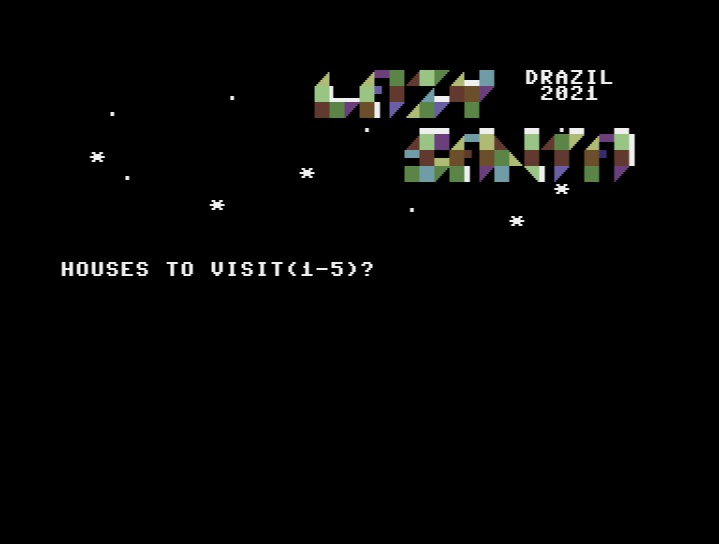 <b>Commodore 64</b> <i>Lazy Santa</i> (drazil, 2021)</td>
<td align="center" valign="top" width="33%">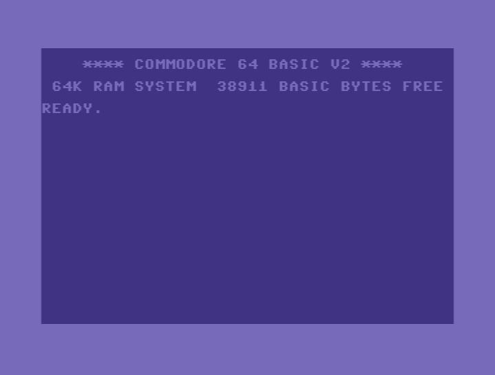 <b>Commodore 64</b> BASIC V2</td>
<td align="center" valign="top" width="33%">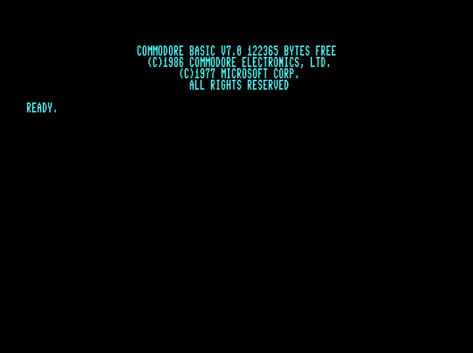 <b>Commodore 128</b> 80 columns on the VDC</td>
</tr>
<tr>
<td align="center" valign="top" width="33%">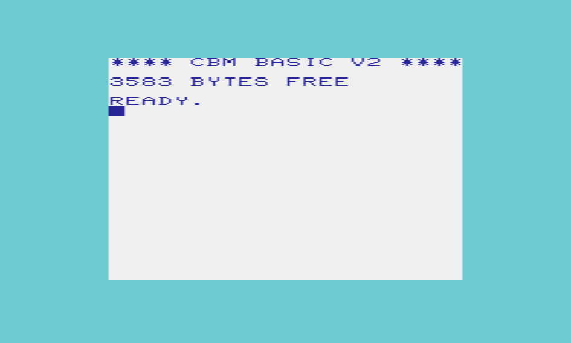 <b>VIC-20</b> BASIC V2</td>
<td align="center" valign="top" width="33%">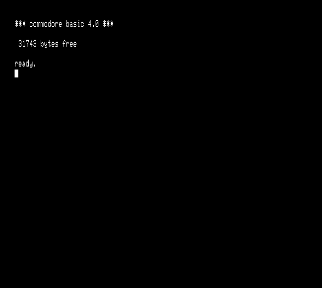 <b>PET 8032</b> BASIC 4.0, 80 columns</td>
<td align="center" valign="top" width="33%">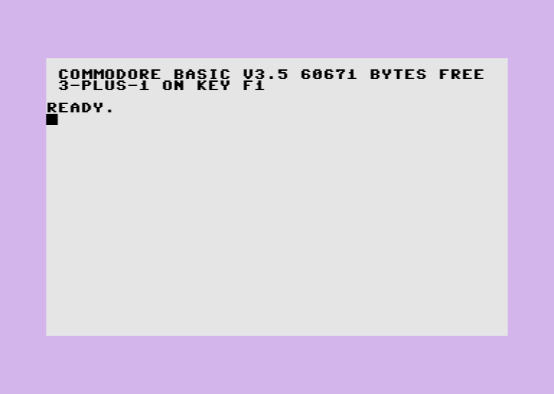 <b>Plus/4</b> BASIC 3.5</td>
</tr>
<tr>
<td align="center" valign="top" width="33%">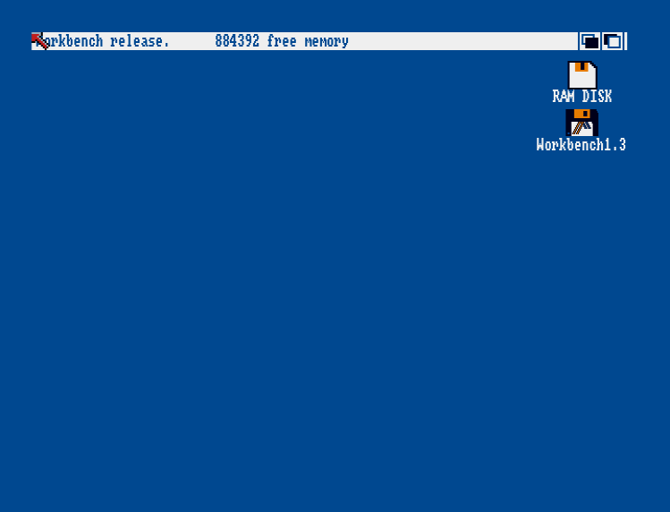 <b>Amiga 500</b> Workbench 1.3</td>
<td align="center" valign="top" width="33%">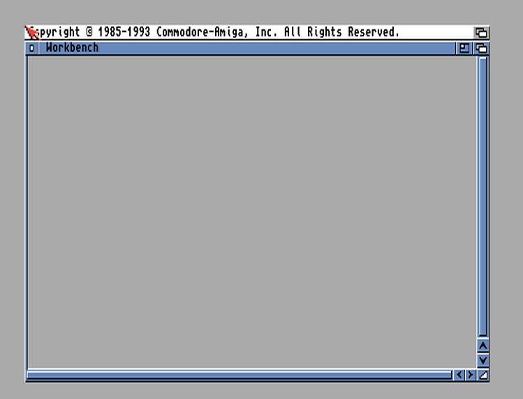 <b>Amiga 1200</b> Kickstart 3.1</td>
<td align="center" valign="top" width="33%">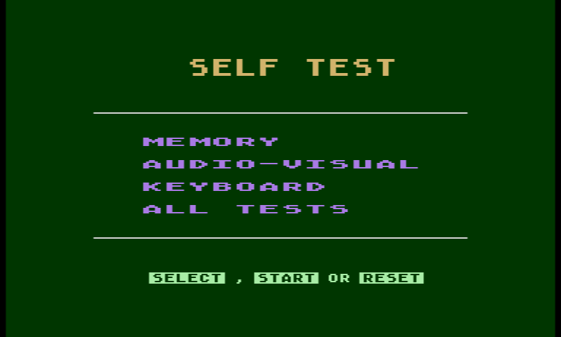 <b>Atari 800XL</b> Self test</td>
</tr>
<tr>
<td align="center" valign="top" width="33%">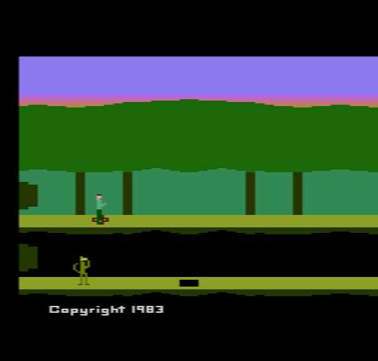 <b>Atari 2600</b> <i>Pitfall II</i></td>
<td align="center" valign="top" width="33%">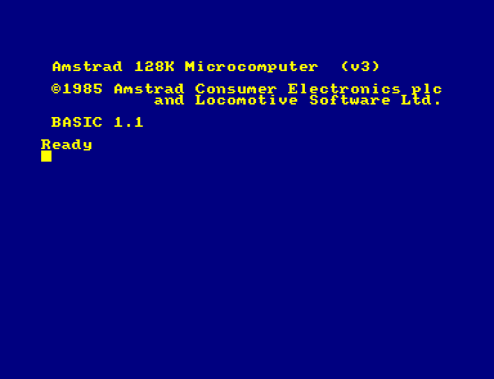 <b>Amstrad CPC 6128</b> BASIC 1.1</td>
<td align="center" valign="top" width="33%">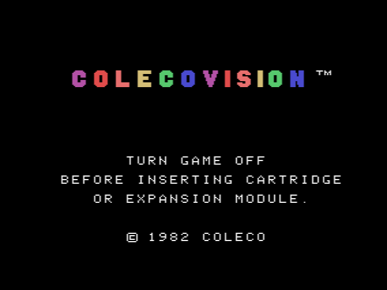 <b>ColecoVision</b> BIOS title</td>
</tr>
<tr>
<td align="center" valign="top" width="33%">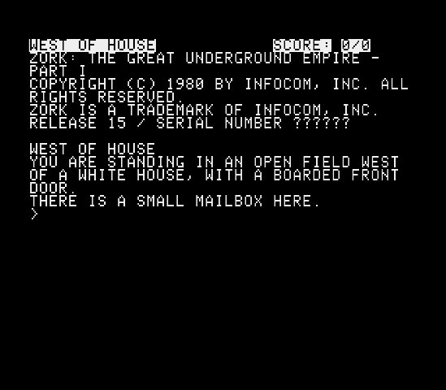 <b>Apple IIe</b> <i>Zork I</i></td>
<td align="center" valign="top" width="33%">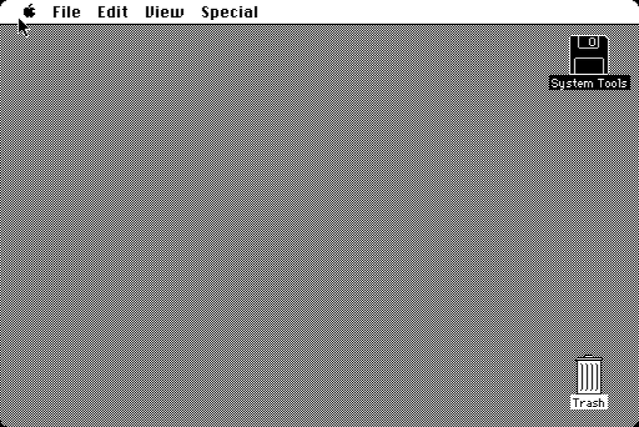 <b>Macintosh Plus</b> System 6.0.8 Finder</td>
<td align="center" valign="top" width="33%">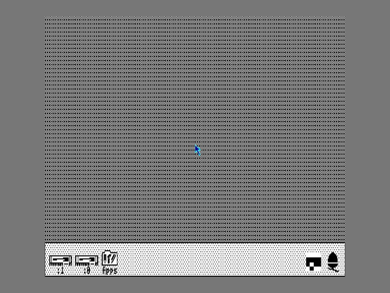 <b>Archimedes A310</b> RISC OS 3.11 Desktop</td>
</tr>
<tr>
<td align="center" valign="top" width="33%">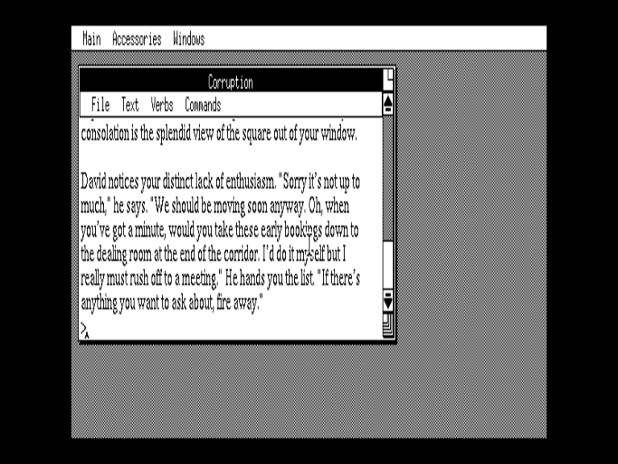 <b>Archimedes A310</b> <i>Corruption</i> (Magnetic Scrolls)</td>
<td align="center" valign="top" width="33%">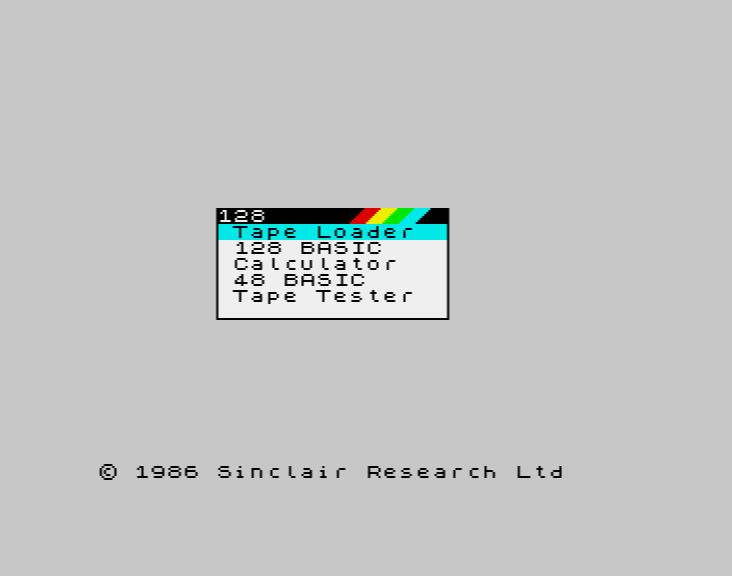 <b>ZX Spectrum 128K</b> Start menu</td>
<td align="center" valign="top" width="33%"> <b>ZX81</b> BASIC prompt</td>
</tr>
<tr>
<td align="center" valign="top" width="33%">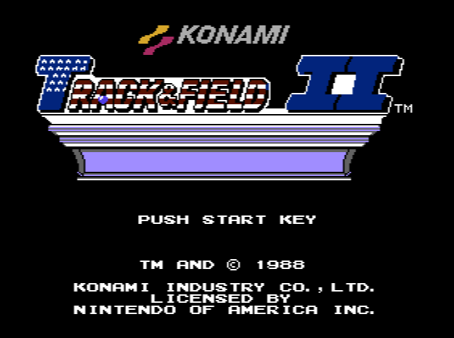 <b>NES</b> <i>Track &amp; Field II</i></td>
<td align="center" valign="top" width="33%">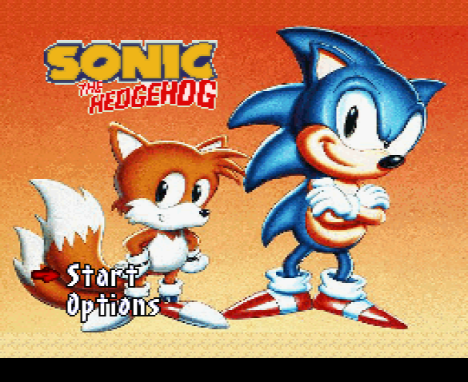 <b>SNES</b> <i>Sonic the Hedgehog 4</i></td>
<td align="center" valign="top" width="33%">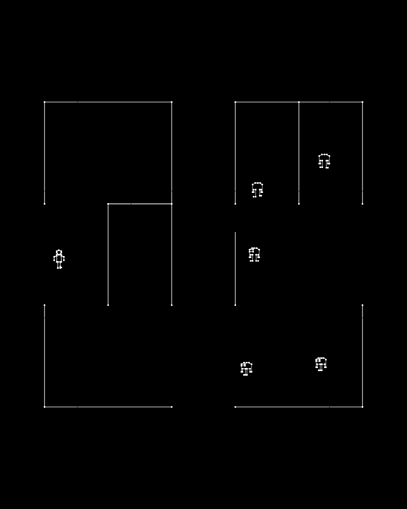 <b>Vectrex</b> <i>Berzerk</i></td>
</tr>
<tr>
<td align="center" valign="top" width="33%">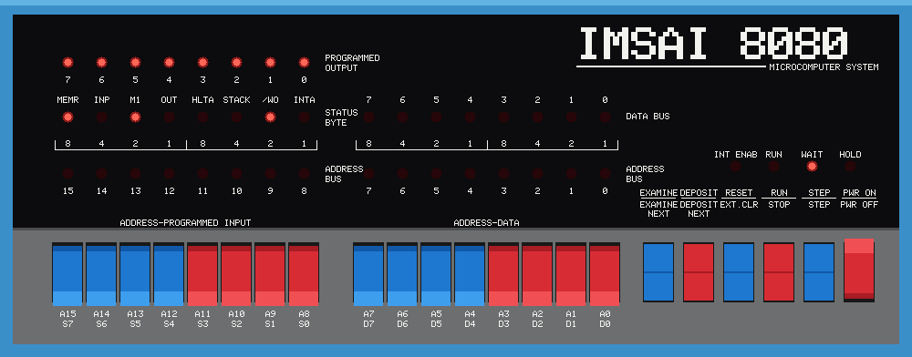 <b>IMSAI 8080</b> Front panel, clickable</td>
</tr>
</table>

## Status

**Completeness** estimates how much of the planned scope of a component works and is covered by tests. 100 % means the full scope is done and checked against hardware test suites. Below that, the notes name what is missing or unverified. The figures are estimates, made from the test results and open items recorded in `CLAUDE.md` (as of 2026-10-24); they are not measurements.

### CPUs

| CPU | Crate | Used in | Verification | Completeness |
| --- | --- | --- | --- | --- |
| MOS 6502 family: 6502, 6510, 8502, 7501/8501, 6502C (SALLY), 6507, Ricoh 2A03/2A07, CMOS 65C02 | `cpu-6502` | PET, VIC-20, C64, C128, C16/Plus/4, 1541/1571/1581, Atari 8-bit, Atari 2600, NES, Apple II | Tom Harte (6502, nes6502, synertek65c02), Klaus Dormann, Lorenz 264/264 | 97 % (no Rockwell/WDC bit instructions, WAI/STP) |
| Zilog Z80 | `cpu-z80` | C128, CPC, ZX81, ColecoVision | Tom Harte, ZEXDOC, ZEXALL | 97 % |
| Motorola 68000 | `cpu-m68k` | Amiga 500/1000/2000/500+, Macintosh | Tom Harte (all but three contradictory cases) | 97 % |
| Motorola 68020 / 68EC020 | `cpu-m68k` | Amiga 1200 | unit tests only; timing approximate, no cache | 60 % |
| WDC 65C816 (5A22) | `cpu-65816` | SNES | Tom Harte, all 5 080 400 tests | 95 % |
| Sony SPC700 | `cpu-spc700` | SNES sound module | Tom Harte, all 256 000 tests | 98 % |
| Motorola 6809 (68A09) | `cpu-6809` | Vectrex | own per-instruction tests (cycle counts from the datasheet); the Vectrex executive and Scramble run; no external test suite | 75 % |

### Machines

| Machine | Crate | Models | Verification / state | Completeness |
| --- | --- | --- | --- | --- |
| Commodore 64 | `machine-c64` | PAL, NTSC | Lorenz 264/264; debugged with VS64 through the VICE monitor | 95 % |
| Commodore VIC-20 | `machine-vic20` | PAL, NTSC, RAM expansions | boots BASIC, tape, cartridges | 85 % |
| Commodore PET | `machine-pet` | 2001, 3032, 4032, 8032 | boots BASIC; IEEE drive virtual only (no true 2031) | 85 % |
| Commodore C16 / Plus/4 | `machine-ted` | PAL, NTSC | boots BASIC, tape, cartridges | 85 % |
| Commodore 128 | `machine-c128` | 40/80 columns, Z80 | boots BASIC; VDC; 1571 | 80 % |
| Atari 400/800/800XL/65XE/130XE | `machine-atari8` | PAL, NTSC | Acid800 52/57 (800XL, 130XE); 5 ANTIC/GTIA edge cases open | 90 % |
| Atari 2600 | `machine-atari2600` | NTSC, PAL (auto-detected) | own TIA/RIOT tests, 24 games, Pitfall II (DPC); Supercharger, SECAM missing | 88 % |
| Amstrad CPC | `machine-cpc` | 464, 664, 6128; CRTC 0–2 | Arnold acid tests 66/70; tape and disc | 90 % |
| Amiga 500/1000/2000 (OCS) | `machine-amiga` | PAL, NTSC | Kickstart 1.2–3.1, Workbench 1.3, demos; bus timing against WinUAE within 0.2–3 % | 85 % |
| Amiga 500+ (ECS) | `machine-amiga` | `500plus` | Kickstart 2.0/3.1 reach insert-disk; programmable beam partly | 75 % |
| Amiga 1200 (AGA) | `machine-amiga` | `1200` | Kickstart 3.1 boots the model; boot test row red; Workbench 3.x not booted | 45 % |
| Sinclair ZX81 / TS1000 | `machine-zx81` | 1/2/16 KB | boots, PRINT, .P files through traps | 85 % |
| ColecoVision | `machine-coleco` | NTSC, PAL | 231 of 235 cartridges show a picture; MegaCart; four controller kinds | 90 % |
| NES / Famicom | `machine-nes` | NTSC, PAL, Four Score | 116 of 119 test ROMs; mappers 0–4 | 90 % |
| SNES | `machine-snes` | NTSC, PAL | games run with sound; DSP-1 missing, no SNES test ROMs, mid-line register changes | 70 % |
| Vectrex | `machine-vectrex` | – | executive and Scramble run; light pen and 3D Imager modelled; overlays and phosphor persistence open; Mine Storm and 3-D Mine Storm need the 8 KB system ROM | 55 % |
| Test machine (6502 + RAM + raster chip) | `machine-sim6502` | – | reference for debugger tests | 100 % |
| Tandy TRS-80 Model I/III | – | Phase 10 | – | 0 % |
| Sinclair ZX Spectrum 48K/128K | – | Phase 15 | – | 0 % |
| Apple II / II+ / IIe | `machine-apple2` | II, II+, IIe, enhanced IIe | all four boot with real ROMs; Zork I boots from DSK; a disk built by the tests boots through the Disk II PROMs; cassette save/load through the monitor; colours checked through the composite stage; DOS 3.3/ProDOS disks, Mockingboard software and WOZ copy protections not yet tried | 70 % |
| Apple Macintosh 128K–SE | `machine-mac` | 128K, 512K, Plus, SE | all four reach the disk icon with real ROMs (startup sound, RTC, memory test); a disk built by the tests boots through the IWM (400K with the 128K's speed control, 800K); SCSI disks, ADB, SCC and keyboard only unit-tested; System 6 not yet tried | 55 % |

### Chips

| Chip | Crate | Machines | Completeness |
| --- | --- | --- | --- |
| MOS 6560/6561 VIC | `chips-cbm` | VIC-20 | 85 % |
| MOS 6567/6569 VIC-II, 8564/8566 VIC-IIe | `chips-cbm` | C64, C128 | 95 % |
| MOS 7360/8360 TED | `chips-cbm` | C16, Plus/4 | 85 % |
| MOS 8563 VDC | `chips-cbm` | C128 | 80 % |
| MOS 6581/8580 SID | `chips-cbm` | C64, C128 | 85 % |
| MOS 6526 CIA / 8520 | `chips-cbm` | C64, C128, 1571, 1581, Amiga | 95 % |
| MOS 6522 VIA | `chips-cbm` | VIC-20, PET, 1541, Vectrex, Macintosh | 90 % (shift-in at the φ2 rate, PB6 pulse counting missing) |
| Zilog Z8530 SCC | `machine-mac` | Macintosh | 50 % (DCD interrupts, vector, loopback; no baud rates or sync modes) |
| NCR 5380 SCSI | `machine-mac` | Macintosh Plus, SE | 70 % (no timing, no arbitration with other initiators) |
| Apple IWM | `drives-other` | Macintosh | 80 % |
| MOS 6520/6821 PIA | `chips-cbm` | PET, Atari 8-bit | 85 % |
| MOS 6545 CRTC | `chips-cbm` | PET 4032/8032 | 80 % |
| MOS 8722 MMU, PLA | `chips-cbm` | C128, C64 | 90 % |
| Agnus/Alice: DMA slots, Copper, Blitter | `chips-amiga` | Amiga | 90 % OCS, 75 % ECS, 45 % AGA |
| Denise/Lisa | `chips-amiga` | Amiga | 85 % OCS/ECS, 45 % AGA |
| Paula: audio, disk, UART | `chips-amiga` | Amiga | 85 % |
| ANTIC | `chips-atari` | Atari 8-bit | 85 % |
| GTIA | `chips-atari` | Atari 8-bit | 85 % |
| POKEY | `chips-atari` | Atari 8-bit | 85 % |
| TIA | `chips-atari` | Atari 2600 | 90 % |
| RIOT 6532 | `chips-atari` | Atari 2600 | 95 % |
| CRTC 6845 (types 0–2) | `chips-amstrad` | CPC | 85 % |
| Gate Array | `chips-amstrad` | CPC | 90 % |
| AY-3-8912 | `chips-amstrad` | CPC, Vectrex, Apple II Mockingboard | 90 % |
| 8255 PPI | `chips-amstrad` | CPC | 85 % |
| µPD765 FDC | `chips-amstrad` | CPC 664/6128 | 80 % |
| TMS9918A/TMS9929A VDP | `chips-ti` | ColecoVision | 80 % (VRAM access timing, reference pictures open) |
| SN76489 | `chips-ti` | ColecoVision | 90 % |
| PPU 2C02/2C07 | `chips-nintendo` | NES | 90 % |
| 2A03 APU | `chips-nintendo` | NES | 85 % |
| S-PPU | `chips-nintendo` | SNES | 70 % |
| S-DSP | `chips-nintendo` | SNES | 80 % |
| ZX81 ULA | `chips-sinclair` | ZX81 | 85 % |
| WD177x FDC | `drives-cbm` | 1581 | 80 % |

### Drives and storage

| Device | Crate | Completeness |
| --- | --- | --- |
| 1541 (true drive emulation, GCR) | `drives-cbm` | 90 % |
| 1571, 1581 | `drives-cbm` | 80 % |
| Virtual IEC/IEEE drives (host folders, images) | `drives-cbm` | 85 % |
| True 2031 (IEEE-488) | – | 0 % |
| Datasette (TAP, PRG recording) | `drives-other` | 85 % |
| Amiga floppy DF0–DF3 (MFM, DD/HD, write-back) | `drives-other` | 90 % |
| Atari SIO drives 810/1050/XF551, cassette | `drives-other` | 85 % |
| CPC disc drives and tape | `drives-other` | 85 % |
| Apple Disk II (P6 sequencer or functional model, quarter tracks, write-back), cassette (WAV) | `drives-other` | 80 % |
| Sony 400K/800K drives (GCR zones, tachometer, PWM speed control, write-back), SCSI hard disks | `drives-other`, `machine-mac` | 75 % |
| Image formats: PRG, D64/D71/D81, T64, TAP, CRT, ADF/extended ADF, DMS, ATR, XEX, CAS, CAR, DSK/EDSK, CDT/TZX, DMK, Apple DSK/DO/PO/NIB, WOZ 1/2, Mac DSK/DiskCopy 4.2, WAV | `media` | 90 % |
| Backends: image file, copy-on-write overlay, host directory | `media-backends` | 90 % |
| Real-hardware backends (OpenCBM, flux readers) | – | 0 % |

### Input devices

| Device | Ports | Completeness |
| --- | --- | --- |
| Digital joystick | CBM, Atari, CPC, Amiga, Coleco, NES, SNES, Apple II | 100 % |
| Paddles | CBM, Atari | 90 % |
| 1351 mouse | CBM | 90 % |
| Amiga mouse (quadrature) | Amiga | 95 % |
| Macintosh mouse (quadrature; ADB on the SE), keyboard M0110/M0110A, ADB keyboard | Macintosh | 50 % (directions and keys not yet checked under a running system) |
| AMX mouse | CPC | 85 % |
| Atari keypad, driving controller | Atari | 85 % |
| ColecoVision controller, Super Action, Driving Module, Roller Controller | Coleco | 75 % (several details unverified) |
| NES controller, Zapper, Arkanoid | NES | 90 % |
| SNES pad, mouse, Super Scope, multitap | SNES | 85 % |
| Vectrex controller (analog stick), light pen | Vectrex | 70 % |
| Vectrex 3D Imager (motor, index pulse, colour wheel) | Vectrex | 40 % (not yet checked with a game) |
| Apple II joystick (analog) and paddles | Apple II | 80 % |
| C64/Atari light pens | – | 0 % |
| Host gamepads (`gilrs`: Xbox 360 and other XInput/HID pads; D-pad, left stick digital or analog, A/B/X/Y, shoulders, Back/Start) | all joystick ports | 85 % (only the first pad mapped by default; no mapping UI) |

### Cartridges

| Cartridge type | Crate | Completeness |
| --- | --- | --- |
| C64/C128 CRT: banking types, EasyFlash | `devices-cartridge` | 85 % |
| Freezer cartridges (Action Replay, Retro Replay, Final Cartridge III) | – | 0 % |
| VIC-20, C16/Plus/4 ROM cartridges | `devices-cartridge` | 90 % |
| Atari 8-bit CAR | `devices-cartridge` | 85 % |
| Atari 2600 bank switching (2K/4K, F8/F6/F4 + Superchip, FE, E0, E7, 3F, FA, DPC) | `devices-cartridge` | 88 % |
| ColecoVision (plain, MegaCart) | `devices-cartridge` | 90 % |
| NES mappers 0–4 (iNES/NES 2.0) | `devices-cartridge` | 60 % (further mappers missing) |
| SNES LoROM/HiROM/ExHiROM, SRAM | `devices-cartridge` | 60 % (no coprocessors, SRAM not saved to file) |
| Vectrex (32 KB, 64 KB with PB6 banking) | `devices-cartridge` | 90 % |

### Network devices

| Device | Crate | Completeness |
| --- | --- | --- |
| Ultimate 64 command interface (C64 `uci=on`): DOS targets on a host folder, network target (TCP/UDP sockets), control identify | `devices-net` | 70 % (Ultimate control commands not offered; error texts and timing partly unverified) |
| WiC64 on the user port (C64 `userport=wic64`): legacy and protocol 2, HTTP GET/POST, TCP, info, time | `devices-net` | 70 % (no https; handshake timing and some answers unverified) |
| Host network and folder (`media-backends`), journalled for exact replays | `emu-core::host` | 80 % (no TLS; the web frontend has no network) |

### Debugger, preview and frontends

| Component | Crate | Completeness |
| --- | --- | --- |
| Debug server (native JSON protocol, breakpoints, raster trace, savestates, freezer, cheat search) | `emu-debug` | 85 % |
| VICE binary monitor adapter | `emu-debug` | 85 % |
| Graphics data views (sprites, charsets, bitmaps) | – | 0 % |
| Live preview (snapshots, WebSocket stream, raw stream) | `emu-preview` | 85 % |
| CRT emulation (signal stage, scanlines, masks, profiles) | `video-crt` | 70 % (full CRT stage, vector persistence open) |
| Desktop frontend (window, sound, gamepads, drag & drop) | `emu-desktop` | 85 % |
| Headless runner | `emu-headless` | 95 % |
| Web frontend (WASM) | `emu-web` | 5 % |
